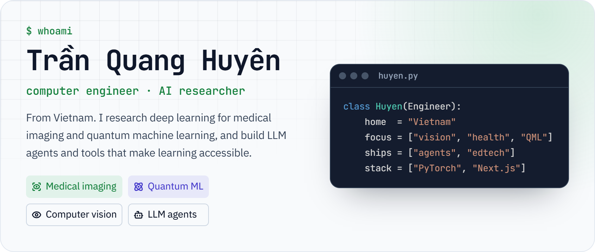
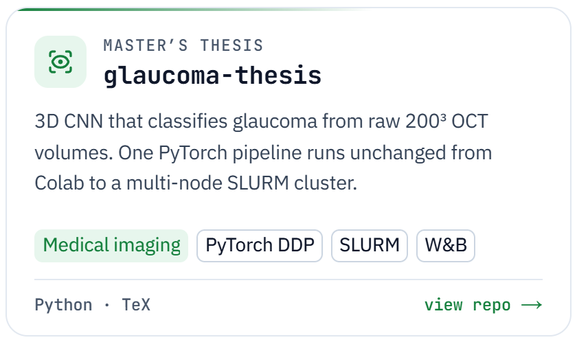
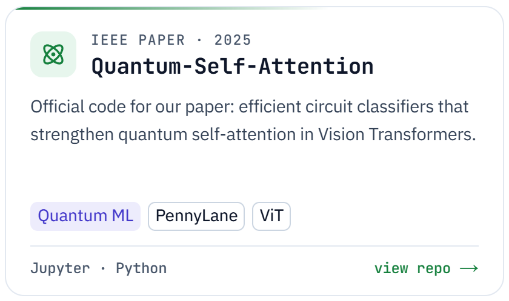
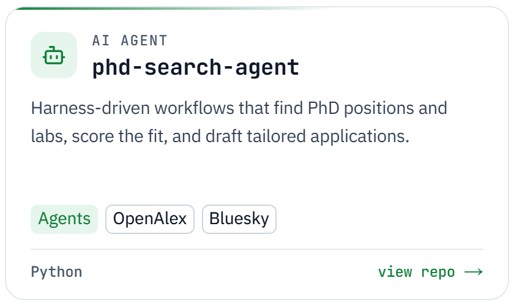
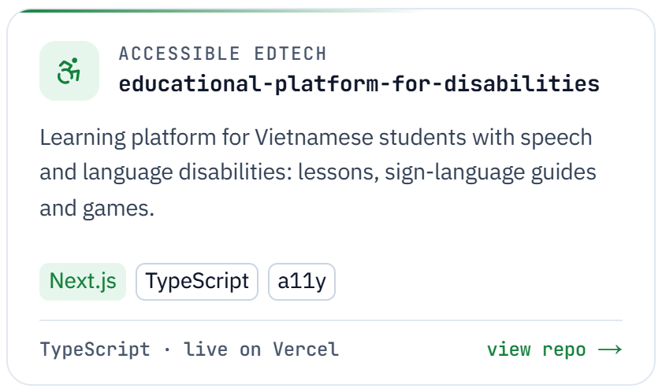
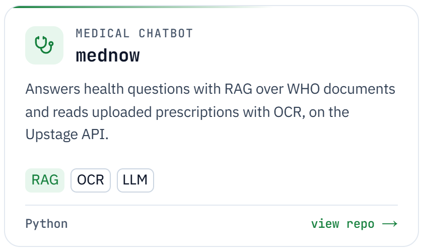
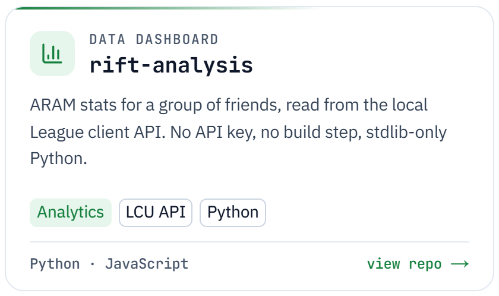
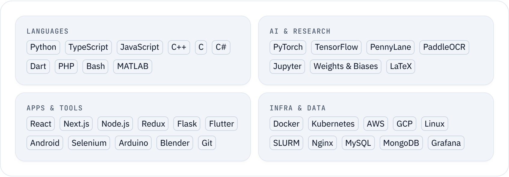

<!--
  The banner, project cards and toolbox in assets/ are rendered by an OpenUI
  studio (`pnpm dlx @openuidev/cli@latest create`): OpenUI Lang programs on the
  built-in library plus Hero and ProjectCard components, themed with tokens
  from ui-ux-pro-max. Every image has a light and a dark variant.
-->

<picture>
  <source media="(prefers-color-scheme: dark)" srcset="assets/hero-dark.png">
  
</picture>

  
  
  
  
  

## About

- **Research:** deep learning for medical imaging (glaucoma detection from 3D OCT scans, brain tumor segmentation from MRI) and quantum self-attention for Vision Transformers.
- **Building:** LLM agents, and tools that make learning accessible.
- **Writing:** essays on education and tech, in Vietnamese, on [Substack](https://tqhuyen.substack.com/).

## Featured work

<a href="https://github.com/Tqhuyen/glaucoma-thesis"><picture><source media="(prefers-color-scheme: dark)" srcset="assets/card-glaucoma-dark.png"></picture></a>
<a href="https://github.com/Tqhuyen/Quantum-Self-Attention"><picture><source media="(prefers-color-scheme: dark)" srcset="assets/card-quantum-dark.png"></picture></a>
<a href="https://github.com/Tqhuyen/phd-search-agent"><picture><source media="(prefers-color-scheme: dark)" srcset="assets/card-phd-agent-dark.png"></picture></a>
<a href="https://github.com/Tqhuyen/educational-platform-for-disabilities"><picture><source media="(prefers-color-scheme: dark)" srcset="assets/card-edu-dark.png"></picture></a>
<a href="https://github.com/Tqhuyen/mednow"><picture><source media="(prefers-color-scheme: dark)" srcset="assets/card-mednow-dark.png"></picture></a>
<a href="https://github.com/Tqhuyen/rift-analysis"><picture><source media="(prefers-color-scheme: dark)" srcset="assets/card-rift-dark.png"></picture></a>

## Research

**Efficient Circuit Classifier Design for Enhancing Quantum Self-Attention in Vision Transformers** 
**Huyen Quang Tran**, Yu-Han Lin, Hanh Thi Minh Tran, Duy-Tuan Dao, Van-Linh Nguyen · IEEE Globecom Workshops (GC Wkshps), 2025 
[Paper](https://ieeexplore.ieee.org/document/11591004) · [Code](https://github.com/Tqhuyen/Quantum-Self-Attention)

**Comparative Analysis of Deep Learning Architectures for Brain Tumor Segmentation** 
**Huyen Quang Tran**, Hieu Pham, Phuc Ho, Hanh Thi Minh Tran · International Conference on Advanced Technologies for Communications (ATC), 2025 
[Paper](https://ieeexplore.ieee.org/document/11268774) · [Code](https://github.com/PhamDoanMinhHieu/Comparative-Analysis-of-Deep-Learning-Architectures-for-Brain-Tumor-Segmentation)

## Toolbox

<picture>
  <source media="(prefers-color-scheme: dark)" srcset="assets/stack-dark.png">
  
</picture>

## Activity

<picture><source media="(prefers-color-scheme: dark)" srcset="https://github-readme-stats.vercel.app/api?username=Tqhuyen&show_icons=true&disable_animations=true&custom_title=GitHub%20stats&border_radius=16&bg_color=1B2336&border_color=334155&title_color=22C55E&text_color=CBD5E1&icon_color=22C55E&ring_color=22C55E"></picture>
<picture><source media="(prefers-color-scheme: dark)" srcset="https://github-readme-stats.vercel.app/api/top-langs?username=Tqhuyen&layout=compact&langs_count=8&hide=html%2Ccss%2Cscss%2Cless&disable_animations=true&border_radius=16&bg_color=1B2336&border_color=334155&title_color=22C55E&text_color=CBD5E1"></picture>

<picture>
  <source media="(prefers-color-scheme: dark)" srcset="https://streak-stats.demolab.com?user=Tqhuyen&disable_animations=true&border_radius=16&background=1B2336&border=334155&stroke=334155&ring=22C55E&fire=22C55E&currStreakNum=F8FAFC&sideNums=F8FAFC&currStreakLabel=22C55E&sideLabels=CBD5E1&dates=94A3B8">
  
</picture>

## Latest writing

- [Những suy nghĩ của tôi về vấn đề giáo dục](https://tqhuyen.substack.com/p/nhung-suy-nghi-cua-toi-ve-van-e-giao) · Oct 3, 2026
- [Cử nhân khó làm việc: Đừng biến đại học thành trường dạy nghề](https://tqhuyen.substack.com/p/cu-nhan-kho-lam-viec-ung-bien-ai) · Oct 3, 2026
- [Cách dùng API của League of Legends](https://tqhuyen.substack.com/p/cach-dung-api-cua-league-of-legends) · Apr 25, 2025

  

